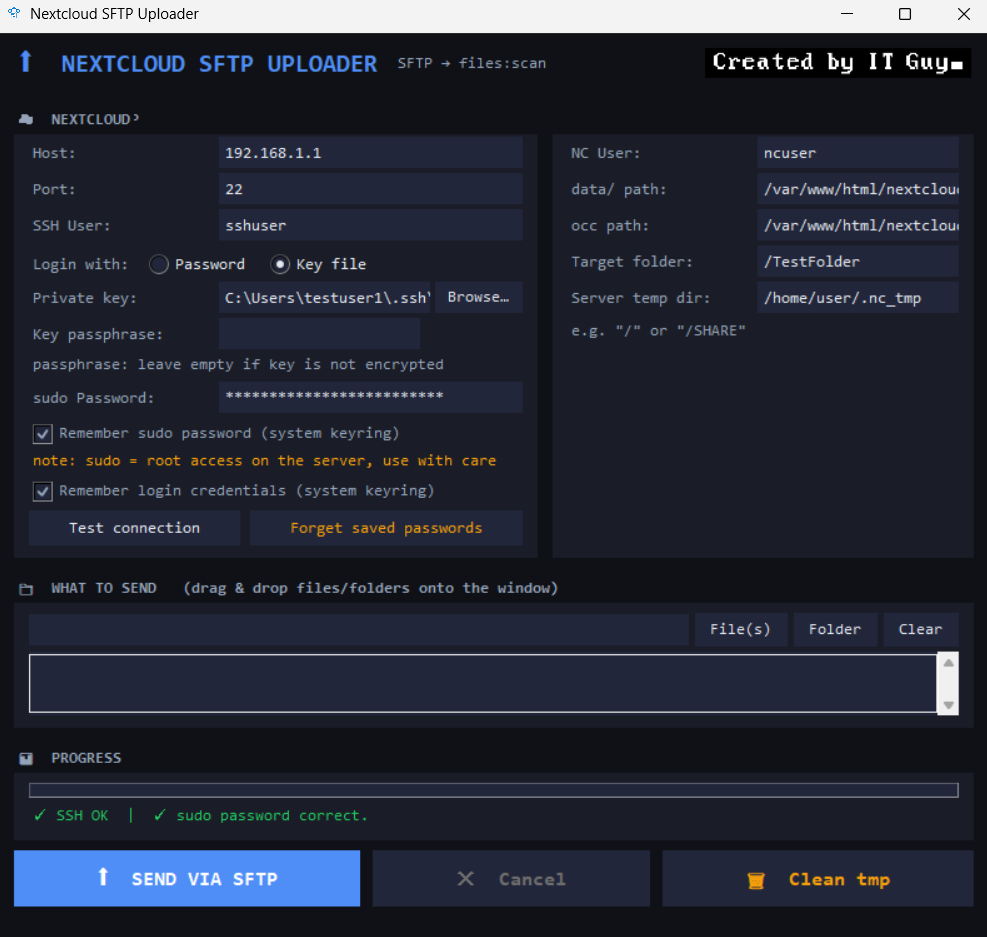

# Nextcloud SFTP Uploader (ncsender)

A desktop GUI tool for uploading large files and folders directly to a Nextcloud server via SSH/SFTP – bypassing WebDAV limitations, chunking timeouts, and Cloudflare restrictions.

Built for home lab setups where the official Nextcloud desktop client struggles with very large files (10 GB+).

---



## Why this exists

The official Nextcloud desktop client uses WebDAV chunked uploads. When a file is fully uploaded, the server must **assemble all chunks into one file** (the MOVE phase). For very large files this can take several minutes – and if the connection times out during assembly (e.g. due to Cloudflare Tunnel), the entire upload is restarted from scratch.

This tool avoids that problem entirely by sending files **directly over SSH/SFTP** into a temp directory on the server. When that directory is on the same filesystem as the Nextcloud data, the final move is an **atomic kernel rename** (`mv`) – instantaneous regardless of file size – followed by a `files:scan` to register the files in Nextcloud's database.

---

## Features

- Upload files and folders of any size (tested with 120 GB+); drag & drop onto the window
- Login with **password** or **SSH key file** (OpenSSH / PEM, optional passphrase)
- Progress bar with real-time speed and ETA
- Automatic `files:scan` after upload – files appear in Nextcloud immediately
- Fresh SFTP session per file – fixes `Bad message` / `Socket closed` errors on multi-file folders
- Configurable **Server temp dir** and a **free-space check** before the upload starts
- On failure it shows how far it got and how much space is left on the server, and writes a log
- Clean tmp button – removes leftover temp files if an upload was interrupted
- Remember credentials option – passwords are stored in the **system keyring** (Windows Credential Manager), never in the settings file; "Forget saved passwords" button
- Cancel button works at any stage

---

## Download

Go to the [Releases](../../releases) page and download the latest `ncsender.exe`. Check its SHA-256 against the value in the release notes.

No installation required – just run the exe.

> **Note:** Windows Defender / SmartScreen or other antivirus software may flag the exe as suspicious because it is not code-signed. This is a false positive ("More info" → "Run anyway"). If you prefer, run it from source (see below).

---

## Requirements

### Client (Windows)
- Windows 10 or newer
- No Python or additional software needed (for the exe)

### Server
- Linux with SSH access
- Nextcloud installed (tested with Nextcloud 29–33)
- User with `sudo` access
- The web server user is `www-data` (Debian / Ubuntu default). The tool uses it for file ownership and for `occ`; other setups are not supported yet.
- For the instant move, the temp dir (default `/tmp`) should be on the same filesystem as the Nextcloud data directory (standard on most setups). If it is not, the move becomes a copy – slower and it needs the space twice. Pick another **Server temp dir** if `/tmp` is small.

---

## Configuration

Fill in the fields in the GUI:

- **Host** – SSH server IP or hostname, e.g. `192.168.1.100`
- **Port** – SSH port, default `22`
- **SSH User** – your Linux username
- **Login with** – *Password*, or *Key file* (browse to your private key; fill in the passphrase if it is encrypted)
- **sudo Password** – needed for the move and the scan
- **NC User** – your Nextcloud username
- **data/ path** – path to the Nextcloud data directory, e.g. `/var/www/html/nextcloud/data`
- **occ path** – path to the Nextcloud occ script, e.g. `/var/www/html/nextcloud/occ`
- **Target folder** – destination folder inside Nextcloud, e.g. `/Downloads`
- **Server temp dir** – where files are uploaded first, default `/tmp`

Use **Test connection** to check SSH and the sudo password.

Tick **Remember login credentials** and/or **Remember sudo password** to keep them in the system keyring between sessions. If the PC has no keyring, passwords are not saved.

---

## How it works

```
Windows                          Linux Server
───────                          ────────────
Select file/folder
        │
        ▼
SSH connect ─────────────────► Create <temp dir>/.nc_upload_<random>/
        │                      check free space
        ▼
SFTP upload ─────────────────► <temp dir>/.nc_upload_<random>/<file>
(fresh session per file)
        │
        ▼
sudo script ─────────────────► mv → /nextcloud/data/user/files/SHARE/<file>
                                chown www-data:www-data
                                chmod 640
                                occ files:scan
        │
        ▼
✓ Done – file visible in Nextcloud
```

---

## Comparison with official Nextcloud client

**Protocol**
- Official client: WebDAV (chunked upload)
- This tool: SSH/SFTP

**Works through Cloudflare Tunnel**
- Official client: ✗ – times out during chunk assembly (MOVE phase)
- This tool: ✓ – each SFTP transfer is a direct TCP connection, no HTTP timeouts

**File size limit**
- Official client: ~10–20 GB in practice
- This tool: no limit set by the tool (tested with 120 GB+)

**Requires SSH access to server**
- Official client: ✗
- This tool: ✓ – needs SSH login and sudo

**Auto-sync**
- Official client: ✓ – monitors folders and syncs automatically
- This tool: ✗ – manual upload only

**Speed on LAN**
- Both: ~90 MB/s (limited by network, not the tool)

---

## Troubleshooting

Logs are written to your home folder (`C:\Users\<you>\`):
- `NCSender_upload.log` – every upload (start, free space, errors)
- `NCSender_error.log` – a crash while starting the program
- `NCSender_dnd.log` – why drag & drop is unavailable, if it is

**`Bad message` or `Socket closed` on folder upload**
Already handled – the tool opens a fresh SFTP session for each file. If it still happens, open an Issue with the log.

**`Not enough free space`**
Choose another **Server temp dir** on a bigger disk.

**`files:scan` fails**
Check that the `occ path` field points to the correct location. Default is `/var/www/html/nextcloud/occ`.

**Upload succeeds but file not visible in Nextcloud**
Run `files:scan` manually on the server:
```bash
sudo -u www-data php /var/www/html/nextcloud/occ files:scan <username> --quiet
```

**`Key is encrypted`**
Enter the key passphrase. PuTTY `.ppk` keys must be converted to OpenSSH format first.

---

## Security notes

- Passwords (SSH, key passphrase, sudo) are saved only if you tick the "Remember" boxes, and then **only in the system keyring**. The settings file `~/.nextcloud_sftp_uploader.json` (in your user folder) contains host, user and paths, but no passwords.
- The sudo password is sent to `sudo` through a pseudo-terminal on the SSH connection.
- Temp files are created in the temp dir with `chmod 700` (owner-only access); the directory name includes 16 random hex characters.
- **The tool does not verify the server's SSH host key** (unknown hosts are accepted automatically). Use it only with servers and networks you trust, until host key checking is added.
- `sudo` means root on your server. Use a dedicated account if you can.

---

## Run from source

```
pip install paramiko keyring tkinterdnd2
python ncsender.py
```
Needs Python 3 with Tk. Optional files next to the script: `icon.ico` / `icon.png` (window icon) and `created.png` (the logo in the header; clicking it opens the author's page).

The release exe is built with [Nuitka](https://nuitka.net/) (one-file, no console window).

---

## License

MIT License – do whatever you want with it. See [LICENSE](LICENSE). The libraries it uses have their own licenses – see [THIRD_PARTY_NOTICES.md](THIRD_PARTY_NOTICES.md).

---

## Author

Made by [nyorbee](https://www.facebook.com/ajtiguy)
